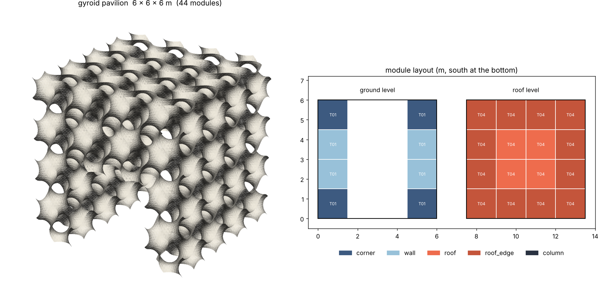

# Minimal-surface pavilion: modular, scalable, 3D printed

First draft of a parametric pavilion built from **triply periodic minimal
surfaces (TPMS)**. The minimum boundary is **6 × 6 × 6 m**. The pavilion grows
in whole modules along any axis.



## Concept

| Idea | How it is implemented |
|---|---|
| **One module = one period of the surface** | Each cubic module (default 1.5 m) holds exactly one unit cell of a gyroid, Schwarz P, diamond or Neovius surface. The sheet is thickened to a printable wall. |
| **Seamless tiling** | The surface repeats with the module size, so neighbouring modules meet on flat faces and the surface carries on without a seam. |
| **Few unique parts** | All modules on the same level are geometrically identical. The default 6 m pavilion has 44 modules but only **4 print files**, one per level, because the sheet thickness is graded from 50 mm at the ground to 30 mm at the roof. With `"levels": "uniform"` there is a single module type. |
| **Scalable** | `size_m` is rounded up to whole modules. Anything below 6 m on any axis is rejected. Walls and roof are `envelope_depth_modules` thick. When the clear span exceeds `max_roof_span_modules`, interior columns are added automatically. |
| **Entrances** | Openings are cut out of the ground-level walls on any side. The corner columns and the roof are always kept. |
| **3D-printable** | Each module type is exported as one watertight solid. If the module is bigger than the printer, it is split into parts that fit the build volume (default 1 m³ → 8 parts per module). The gyroid has no flat overhangs, so it prints without supports. |
| **Assembly** | The manifest lists, for each shared face, the connector points (dowels or bolts) along the contact lands of the sheet, plus the placement and role of every module. |

## Default 6 × 6 × 6 m result

- Grid 4 × 4 × 4 modules of 1.5 m. Walls and roof are 1 module thick. The interior is 3 × 3 m with 4.5 m of clear height.
- There are two 3 × 3 m entrances, one on the south side and one on the north side.
- 44 modules: 12 corner, 16 wall, 12 roof edge, 4 roof.
- Module types (gyroid, rPETG at 1270 kg/m³):

  | Type | Level | Sheet | Volume | Mass | Qty |
  |---|---|---|---|---|---|
  | T01 | 0 | 50 mm | 0.341 m³ | 433 kg | 8 |
  | T02 | 1 | 43 mm | 0.295 m³ | 375 kg | 8 |
  | T03 | 2 | 37 mm | 0.250 m³ | 318 kg | 12 |
  | T04 | 3 (roof) | 30 mm | 0.203 m³ | 258 kg | 16 |

- 352 print parts (1 m build volume), 76 module-to-module joints, ~850 connectors, 8 ground footings.
- Total ~14.4 t of printed polymer.

## Usage

```bash
pip install -r requirements.txt
python pavilion.py                         # default 6 x 6 x 6 m
python pavilion.py --size 12 9 6           # extend: 8 x 6 x 4 modules, adds a column
python pavilion.py --surface schwarz_p     # swap the minimal surface
python pavilion.py -c my.json              # any key of DEFAULT_CONFIG can be overridden
python pavilion.py --manifest-only         # quick quantities, no meshes
```

Outputs go to `out/`. Only `preview.png` and `manifest.json` are committed. The STL files are regenerated:

- `modules/T0n.stl`: one complete module per type
- `parts/T0n_pNN.stl`: the same module split for the printer
- `assembly_preview.stl`: the mid-surface of the whole pavilion, for viewing
- `manifest.json`: placements, roles, connector coordinates, quantities, mass

The main parameters are in `DEFAULT_CONFIG` at the top of `pavilion.py`: surface, module size, extent, envelope depth, graded sheet thickness, entrances, maximum roof span, connector spacing, printer build volume and material.

## Open questions for the next iteration

1. **Material and printing process.** Large-format polymer (rPETG / PP-GF) is assumed. Printed concrete or clay would need thicker sheets (≥ 40–60 mm, i.e. a single nozzle bead) and the overhang angle of each surface would need checking. The gyroid is the safest choice for both. Schwarz P has flat tops that need supports.
2. **Weight.** 14 t is heavy for a polymer pavilion. The options are thinner upper levels, a larger module (fewer, larger cells), or a double-envelope only where it is needed. Only the roof needs to be lighter.
3. **Structure.** No analysis has been done yet. The next step is an FE check of the roof span: the shell/solid mesh of `modules/T0n.stl` can go straight into a solver.
4. **Connections.** The connector points are computed, but the connector geometry is not modelled yet: bosses with inserts on the lands, or printed dovetails.
5. **Weather / enclosure.** The surface is porous and works as a shading screen, not an enclosure. If you need rain cover, one option is to fill the roof cells on one side of the sheet (the gyroid splits space into two labyrinths) or to add a membrane.
6. **Foundations.** The ground-level modules need a footing plate per module (8 for the default).

## Interactive viewer

`viewer/index.html` is a self-contained 3D configurator. It uses the same layout rules as `pavilion.py`, and you can change the extent, surface, entrances and section cut live. It also shows one printable module with its print-part cuts and connector points. Rebuild it after changing the geometry:

```bash
python build_viewer.py   # embeds the module meshes into viewer/template.html -> viewer/index.html
```
